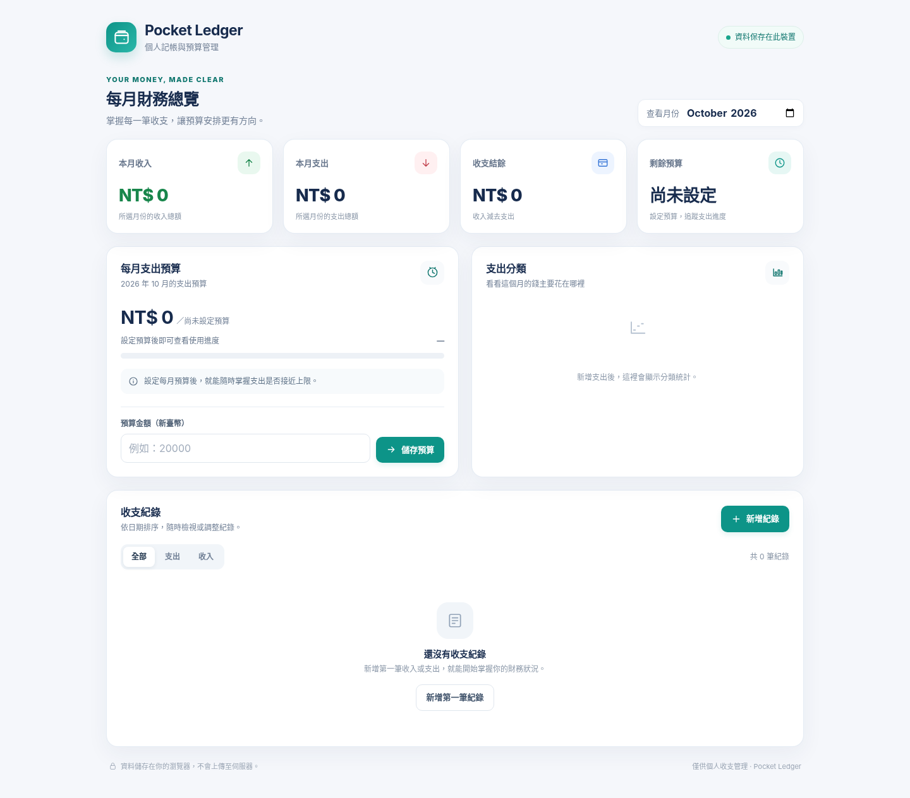

# pocket ledger｜個人記帳與預算管理工具

pocket ledger 是一個使用 HTML、CSS 與原生 JavaScript 製作的個人記帳 Web App。使用者可以記錄日常收入與支出、查看每月財務摘要、設定支出預算，並掌握各支出類別的分布。

本專案以單一 `index.html` 作為網頁主程式，CSS 與 JavaScript 均內嵌於 HTML，不需要後端伺服器、資料庫或外部 API，並可透過 GitHub Pages 公開網站。

## 介面預覽



## 功能特色

- **新增收支紀錄：** 新增收入或支出，填寫項目名稱、金額、日期、分類及備註。
- **編輯與刪除紀錄：** 修改既有紀錄；刪除前會要求確認。
- **每月財務摘要：** 自動計算所選月份的收入、支出、收支結餘及預算剩餘金額。
- **每月預算管理：** 為不同月份分別設定、修改或移除支出預算。
- **預算使用進度：** 顯示已支出金額、預算使用率、剩餘預算，接近或超出預算時提供提示。
- **支出分類統計：** 彙整所選月份各支出類別的金額與比例。
- **月份切換：** 查看不同月份的收支紀錄與統計。
- **收支類型篩選：** 切換查看全部紀錄、收入或支出。
- **本機資料保存：** 使用瀏覽器 `localStorage` 保存收支紀錄與每月預算。
- **響應式介面：** 針對桌面與手機螢幕調整版面。

## 如何使用

1. 開啟網頁後，首頁會顯示目前月份的收入、支出、結餘與預算摘要。
2. 點選「新增紀錄」，選擇收入或支出，填入金額、項目名稱、日期及分類；備註可以不填。
3. 在「每月支出預算」區域輸入大於 0 的整數金額並儲存，即可設定所選月份的預算。
4. 使用月份選擇器查看其他月份，或利用收支類型篩選縮小紀錄清單。
5. 在紀錄清單中使用編輯或刪除操作管理既有資料。

## 計算方式

- **收入總額：** 所選月份所有收入紀錄的金額加總。
- **支出總額：** 所選月份所有支出紀錄的金額加總。
- **收支結餘：** 收入總額 − 支出總額。
- **剩餘預算：** 每月支出預算 − 支出總額。
- **預算使用率：** 支出總額 ÷ 每月支出預算 × 100%。

如果尚未設定預算，介面會顯示尚未設定；支出超出預算時，剩餘預算會以負數呈現並顯示超支提示。

## 資料保存與隱私

收支紀錄與每月預算會保存在目前瀏覽器、目前網站來源的 `localStorage` 中。專案沒有後端資料庫，也不會自動同步資料至其他裝置。

- 重新整理或再次開啟相同網站來源時，瀏覽器通常會保留已儲存的資料。
- 清除瀏覽器網站資料、使用無痕視窗，或更換瀏覽器與裝置，可能造成資料無法繼續使用。
- 本專案沒有帳號登入、雲端備份或跨裝置同步功能。
- 請勿將本工具視為銀行帳戶連線或正式財務服務系統。

## 輸入規則

- 收入與支出金額必須是大於 0 的整數，以新臺幣（NT$）顯示。
- 項目名稱為必填，最多 60 個字。
- 日期與分類為必填。
- 備註為選填，最多 160 個字。
- 每月預算必須是大於 0 的整數；清空預算欄位並儲存，可以移除所選月份的預算。

## 部署至 GitHub Pages

請將本專案的三個檔案放在 GitHub Repository 根目錄：

```text
.
├── index.html
├── README.md
└── pocket-ledger-preview.png
```

接著依照以下步驟啟用 GitHub Pages：

1. 在 GitHub 建立 Repository，並將上述三個檔案上傳至根目錄。
2. 開啟 Repository 的 **Settings → Pages**。
3. 在 **Build and deployment** 的來源選擇 **Deploy from a branch**。
4. 分支選擇 `main`，資料夾選擇 `/(root)`，然後儲存。
5. 等待 GitHub Pages 發布完成，從 Pages 設定頁開啟公開網站。
6. 開啟公開網址後，測試新增、編輯、刪除、預算設定與重新整理後的資料保存功能。
